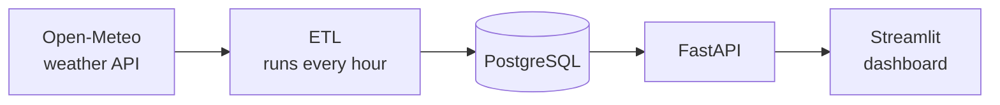

# Weather Data Pipeline

A small data pipeline: every hour it downloads weather data for 6 cities, saves it to a database,
and shows it on a dashboard.


**Built with:** Python, PostgreSQL, FastAPI, Streamlit, Docker, pytest, GitHub Actions

## How it works



1. **ETL** downloads hourly weather from [Open-Meteo](https://open-meteo.com) (free, no API key).
2. The data is checked, cleaned and saved to **PostgreSQL**.
3. **FastAPI** gives access to the data.
4. The **Streamlit** dashboard shows it as tiles, charts and tables.

## Run it

You only need [Docker](https://www.docker.com/).

```bash
docker compose up --build
```

Then open:

- Dashboard: http://localhost:8501
- API: http://localhost:8000/docs

On the first start the pipeline loads the last 30 days, so the dashboard has data right away.

## Dashboard

- **Overview** — the weather right now in each city
- **Trends** — temperature and rain charts for the cities and dates you choose
- **Pipeline health** — when the ETL last ran and whether it worked

## Database

| Table | What's inside |
|---|---|
| `cities` | the 6 cities we track |
| `raw_responses` | API responses exactly as they came |
| `weather_hourly` | cleaned weather, one row per city per hour |
| `weather_daily` | daily summary: min, max, average, total rain |
| `etl_runs` | a log of every ETL run |

## API

| Endpoint | What it returns |
|---|---|
| `/health` | is the API working |
| `/cities` | list of cities |
| `/weather/latest` | current weather for each city |
| `/weather/hourly` | hourly weather for one city and a date range |
| `/weather/daily` | daily summary for one city and a date range |
| `/etl/runs` | recent ETL runs |

## Tests

17 tests check that the data is parsed correctly, saved without duplicates, and that the API works.
They run automatically on GitHub for every change.

```bash
pytest
```

## Key decisions

- **No duplicates.** Running the ETL twice for the same hour updates the row instead of adding a new one.
- **One city failing doesn't stop the rest.** The run is marked `partial`, and the error is saved in the log.
- **Raw data is kept.** If something goes wrong while cleaning, the original response is still there.
- **Time is stored in UTC.** Daily summaries use each city's local time, so daylight saving time
  is handled correctly.
- **Automatic retries.** If the weather API is briefly down, the ETL tries again up to 3 times.

## Run without Docker

```bash
python3.12 -m venv .venv && source .venv/bin/activate
pip install -e ".[dev]"
docker compose up -d db
alembic upgrade head
python -m src.etl.run_once          # load data once
uvicorn src.api.main:app --reload   # start the API
streamlit run src/dashboard/app.py  # start the dashboard
```

To run the tests locally, first create the test database:

```bash
docker compose exec db psql -U weather -c "CREATE DATABASE weather_test"
```
